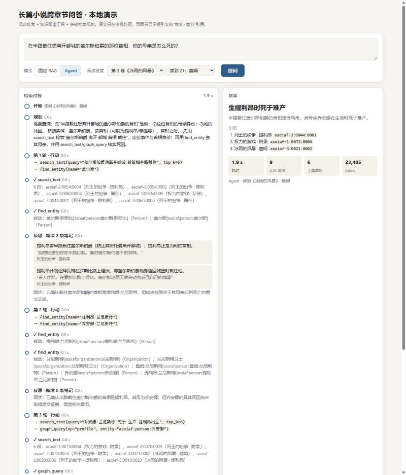
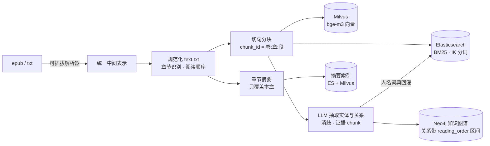
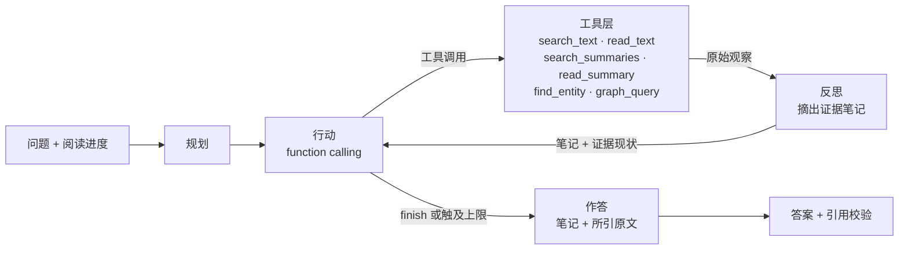
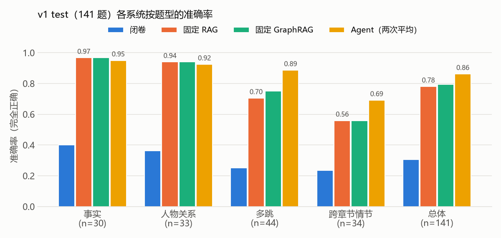
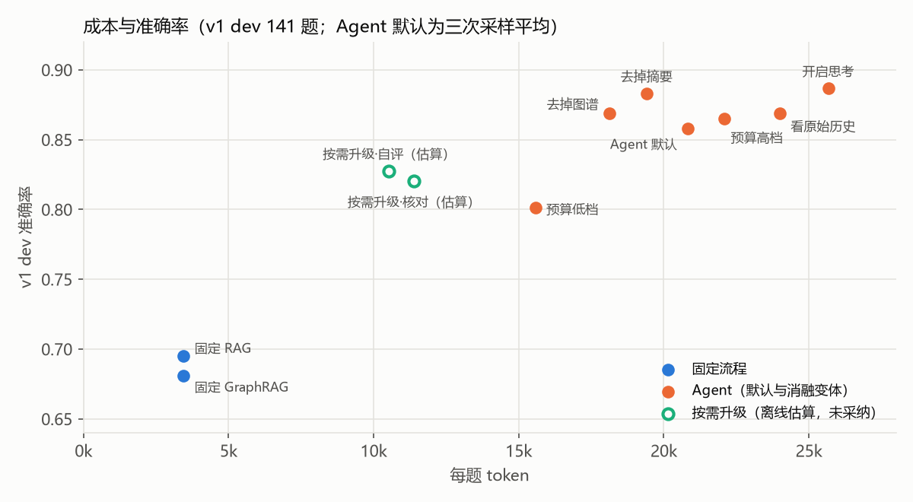
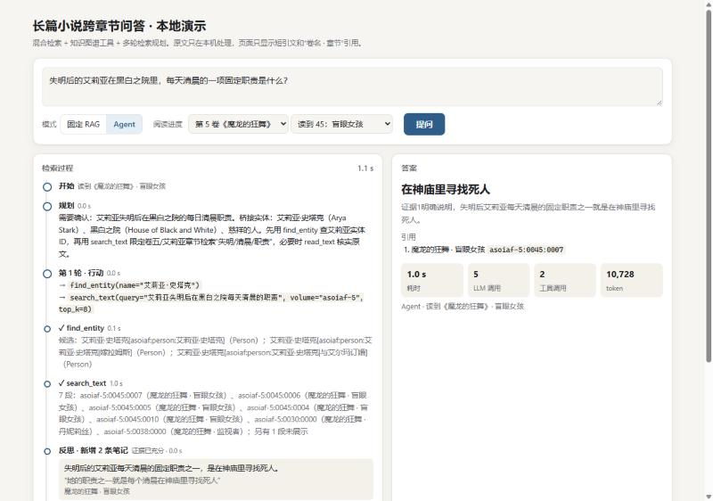

# novel_rag：长篇小说跨章节问答 Agent

[](https://github.com/KyGosh/novel_rag/actions/workflows/ci.yml)

把 **ES BM25 + Milvus 向量混合检索**、**Neo4j 知识图谱查询**、**章节摘要**和**原文读取**封装成工具，由 LangGraph 实现的
“规划 → 检索 → 反思 → 作答”循环自主决定检索路径；与固定流程 RAG、固定 GraphRAG、闭卷基线在同一套评测集上对比。
代码与书籍无关；演示和评测数据集是《冰与火之歌》中文版全五卷（约 300 万字、349 章）。

- **防剧透**：阅读进度 `max_reading_order` 是一等参数，覆盖 BM25、向量、图谱、摘要每一条检索路径，并在工具出口再做一次断言。
- **有证据才作答**：答案只能引用证据笔记里的段落，引用逐条校验；证据不足时回答“原文未提及”。
- **可复现的评测**：评测集金标是字符区间；每次实验记录 commit、配置快照、逐题结果；test 集只在配置冻结后使用并记入台账。
- 仓库**不含原文**。所有数字由脚本从 [`eval/results/`](eval/results/) 生成（[`scripts/make_readme.py`](scripts/make_readme.py)）。



## 架构

离线索引：



在线 Agent 循环（固定流程 RAG 直接调用同一个原文检索工具，作答环节也相同）：



- 行动环节**看不到原始工具输出**，只看证据笔记（结论 + chunk_id + ≤40 字引文）和行动记录；原始观察只交给反思，用完即丢。
- 检索链路：BM25 + 向量 → RRF → bge-reranker-v2-m3；图谱只用参数化的只读 Cypher 模板（强制 LIMIT，不做 Text2Cypher）。
- 上限：轮数、工具调用次数、token；工具失败重试，仍失败就把错误交还给模型；每一步落盘 trace。

## 主要结果（v1 test）

<!-- BEGIN GENERATED: main_results -->
| 系统 | 事实（30） | 人物关系（33） | 多跳（44） | 跨章节情节（34） | 总体（141） | 每题 LLM 调用 | 每题 token |
|---|---|---|---|---|---|---|---|
| 闭卷 | 0.400 | 0.364 | 0.250 | 0.235 | 0.305 | 1.0 | 335 |
| 固定 RAG | 0.967 | 0.939 | 0.705 | 0.559 | 0.780 | 1.0 | 3,445 |
| 固定 GraphRAG | 0.967 | 0.939 | 0.750 | 0.559 | 0.794 | 1.0 | 3,443 |
| Agent（两次采样平均） | **0.950** | **0.924** | **0.886** | **0.691** | **0.862** | 7.4 | 20,473 |

Agent 两次采样的总体准确率：0.844 / 0.879（逐题判分一致率 0.851）。准确率 = judge 判为完全正确的比例（部分正确不计）；95% 置信区间、含部分正确的口径见 [`eval/results/p5_final_comparison.md`](eval/results/p5_final_comparison.md)。

**Agent 相对固定 RAG 的配对差值**（差值 [95% bootstrap CI]）：

| 采样 | 事实 | 人物关系 | 多跳 | 跨章节情节 | 总体 |
|---|---|---|---|---|---|
| 第一次 | -0.033 [-0.10, +0.00] | -0.030 [-0.15, +0.06] | +0.159 [+0.05, +0.30] | +0.118 [+0.03, +0.24] | +0.064 [+0.01, +0.12] |
| 第二次 | +0.000 [+0.00, +0.00] | +0.000 [-0.09, +0.09] | +0.205 [+0.07, +0.36] | +0.147 [+0.00, +0.29] | +0.099 [+0.04, +0.17] |
<!-- END GENERATED: main_results -->



## 关键发现

<!-- BEGIN GENERATED: findings -->
1. **收益来自多轮检索本身，集中在多跳和跨章节题。** test 上 Agent 相对固定 RAG：多跳 +0.159 [+0.05, +0.30] / +0.205 [+0.07, +0.36]，跨章节 +0.118 [+0.03, +0.24] / +0.147 [+0.00, +0.29]；事实题和人物关系题持平（固定 RAG 已接近满分）。
2. **提升不是来自模型自己读过这套书。** 闭卷基线 test 准确率 0.305；在闭卷没答对的多跳 + 跨章节题（59 题）上，固定 RAG 0.576，Agent 0.729 / 0.797。
3. **图谱和摘要工具没有带来可测的准确率提升**（负面结果）。dev 消融：去掉全部图谱 +0.011 [-0.02, +0.04]（token 0.87×），去掉摘要 +0.025 [-0.00, +0.05]（token 0.93×）；固定 GraphRAG 相对固定 RAG 在 test 上 +0.014 [-0.01, +0.04]。图谱工具按用户决定保留在默认配置里，但准确率的提升不能归功于它。
4. **预算有下限，记忆方式省 token。** 预算减半 -0.057 [-0.10, -0.01]（显著变差）；行动环节改看原始工具输出（不用证据笔记）准确率 +0.011 [-0.02, +0.04]，token 1.15×——只看证据笔记更省。
5. **检索链路**（P2，v0 dev）：RRF 融合相对纯向量 cov@4000 +0.108 [+0.02, +0.20]，再加 rerank R@5 +0.128 [+0.03, +0.23]；small-to-big（±1 邻块）在固定 4000 token 预算下 cov@4000 -0.228 [-0.34, -0.12]，所以固定流程不扩展、按需读原文交给 Agent 的工具。
6. **按需升级没有做成**（负面结果）。想法是先走固定 RAG、证据不足才启动 Agent。事先定的门槛是路由对“固定 RAG 没答对的题”的召回率 ≥ 0.75：独立核对 0.628、作答自评 0.702，都不达标，按规则放弃，没有跑 dev 三次采样和 test（[`p6_route_feasibility.md`](eval/results/p6_route_feasibility.md)）。
7. **v0 佐证**（120 题、人工确认过的评测集）：闭卷 0.250、固定 RAG 0.683、Agent 0.742，方向与 v1 一致。
<!-- END GENERATED: findings -->

## 成本与延迟



<!-- BEGIN GENERATED: latency -->
| 系统 | P50 | P95 |
|---|---|---|
| 闭卷 | 1.7 s | 1.9 s |
| 固定 RAG | 2.7 s | 3.5 s |
| Agent | 16.6 s | 28.7 s |

（P4 测量，`eval/results/p4_comparison.md`）
<!-- END GENERATED: latency -->

延迟约九成花在串行的 LLM 调用上；要显著提速，只能减少调用次数（例如反思判定证据充分后跳过只为说“结束”的那次行动、把规划并入第一轮行动），这些都会改变 Agent 的行为，需要重新评测，列在后续工作里。

## Agent 消融（v1 dev）

<!-- BEGIN GENERATED: ablation -->
默认配置三次 dev 运行：0.872 / 0.858 / 0.844（平均 0.858，每题 20,839 token）。

| 变体 | 采样次数 | 准确率 | 相对默认配置 [95% CI] | 多跳 / 跨章节相对默认 | token |
|---|---|---|---|---|---|
| 去掉图谱查询 | 1 | 0.858 | +0.000 [-0.03, +0.03] | +0.000 / +0.029 | 0.90× |
| 去掉全部图谱 | 2 | 0.869 | +0.011 [-0.02, +0.04] | +0.045 / +0.029 | 0.87× |
| 图谱范围只用人物 | 1 | 0.865 | +0.007 [-0.03, +0.04] | +0.000 / +0.029 | 0.99× |
| 去掉摘要 | 2 | 0.883 | +0.025 [-0.00, +0.05] | +0.000 / +0.118 | 0.93× |
| 行动环节看原始历史 | 2 | 0.869 | +0.011 [-0.02, +0.04] | +0.023 / +0.059 | 1.15× |
| 预算低档（3 轮 / 6 次 / 2 万） | 1 | 0.801 | -0.057 [-0.10, -0.01] | -0.068 / -0.118 | 0.75× |
| 预算高档（10 轮 / 20 次 / 6 万） | 1 | 0.865 | +0.007 [-0.03, +0.04] | +0.000 / +0.059 | 1.06× |
| 开启思考 | 1 | 0.887 | +0.028 [-0.01, +0.07] | +0.045 / +0.029 | 1.23× |

（[`eval/results/ablation_qa_v1.md`](eval/results/ablation_qa_v1.md)）
<!-- END GENERATED: ablation -->

## 失败模式

<!-- BEGIN GENERATED: failures -->
Agent 在 dev 上至少一次没答对的 28 题（Claude 归因，未经人工复核）：

| 主要原因 | 题数 |
|---|---|
| 检索侧：某段金标证据没找到 | 14 |
| 作答侧：证据已在笔记，答案漏要点或选错候选 | 6 |
| judge 边界 | 5 |
| 题目本身（歧义或答案不唯一）为主 | 1（另有 6 题涉及） |
| 反思漏记 / 据摘要作答 | 2 |

（[`eval/results/p5_failure_analysis.md`](eval/results/p5_failure_analysis.md)）
<!-- END GENERATED: failures -->

## 设计要点

- **通用性**：代码里没有任何书籍专属知识。书籍相关信息（目录、别名、POV、schema 扩展）都是 `data/books/{book_id}/` 下的可选配置，没有也能跑通；解析器可插拔（epub / txt），下游只认统一中间表示。
- **ID 与坐标**：`chunk_id = {book_id}:{章:04d}:{段:04d}`，ES、Milvus、Neo4j 三处共用；字符位置以规范化后的 `text.txt` 为准；实体 ID 是系列级的。
- **图谱证据**：每个实体和关系都带来源 chunk 和 reading_order 区间；关系随剧情变化，不互相覆盖；查询按阅读进度过滤。
- **工具层与编排框架解耦**：工具是纯函数（`src/novel_rag/tools/`），LangGraph 只在 `agent/` 中出现；固定 RAG 与 Agent 共用同一个检索实现和同一个作答环节，对比只差“是否多轮自主检索”。
- **抽象层**：LLM、Embedding、Reranker 只经过 `llm/` 调用；所有参数集中在 `config.py`；提示词以带版本号的文件存放，LLM 结果按内容 hash 缓存（缓存回放可以逐字复现一次运行）。
- **可复现的评测**：每次运行落盘 commit、去掉密钥的配置快照、逐题结果（不含原文）和 trace 摘要；dev 用于调参与消融，test 只在配置冻结后运行并记入台账；关键对比至少两次采样，报告配对 bootstrap 置信区间。

## 评测方法与局限

- **评测集**：v1（[`eval/datasets/asoiaf_v1`](eval/datasets/asoiaf_v1)，282 题，dev / test 各半）覆盖全五卷，题型为事实（对照组）、人物关系、多跳、跨章节情节；由非被测模型（Claude）按出题规范生成候选题，经原文证据定位校验与独立模型复核，**未经人工复核**。v0（120 题，只覆盖卷一）由人工逐批确认，用作佐证。金标证据是字符区间，不存 chunk_id。
- **判分**：短答案先做规则匹配，匹配不上的交给 LLM judge（DeepSeek，也是被测模型），所以用人工打分验证了一致率：
<!-- BEGIN GENERATED: eval_meta -->
- judge 与人工的一致率：dev 上分层抽 50 条，一致率 0.94，Cohen's κ 0.91；跨章节题的“对 / 部分对”边界最不稳。test 上没有做人工抽查。
- test 台账（[`eval/results/test_runs.jsonl`](eval/results/test_runs.jsonl)）：共 8 次 test 运行，全部来自配置冻结后的同一次确认（commit 3fcb8a7, 4b884b9）。
- Agent 两次运行之间的噪声：test 上总体差 +0.035 [-0.01, +0.09]，逐题判分一致率 0.851。
<!-- END GENERATED: eval_meta -->
- **局限**：
  - test 上 Agent 的领先幅度约为 dev 的一半：Agent 自己的准确率没变，是固定 RAG 在 test 这批题上更强。对外引用以 test 为准。
  - 有 7 道疑似歧义题（“先后用过两个名字”“做过哪两件事”一类问法）没有人工复核。
  - 运行之间有随机性；跨章节题是噪声最大的题组。
  - 失败归因和引用支持度抽查由 Claude 完成，未经人工审阅。
  - 被测模型经本地代理调用，服务端可能更新；阶段开始和结束各做了一次漂移检查（冒烟子集），只能发现大幅漂移。

## 本地演示

```bash
uv run python scripts/ask.py --volume 3 --chapter 21 "问题"     # 命令行：Agent，读到第 3 卷第 21 章
uv run python scripts/ask.py --mode rag "问题"                  # 固定 RAG
uv run python scripts/serve_demo.py                             # Web 演示：http://127.0.0.1:17860
```

Web 演示用 FastAPI + SSE 把每个环节实时推给一个静态单页：规划、工具调用、新增的证据笔记、答案与引用、耗时和 token。只监听本机、单用户；出于版权原因不对外部署。同一个问题把阅读进度往前调，涉及后文的检索会被过滤，答案变成“原文未提及”：

| 读到第 5 卷第 45 章 | 只读完第 3 卷 |
|---|---|
|  |  |

## 复现

需要：Windows / Linux，Python 3.11 + [uv](https://docs.astral.sh/uv/)，Docker，NVIDIA GPU（≥8GB，跑 bge-m3 与 reranker），一个 OpenAI 兼容的 LLM 接口（本项目用 DeepSeek；模型名按任务在 `config.py` / `.env` 中配置）。**语料需自备**，仓库不含原文。

```bash
cp .env.example .env                  # 填写 NEO4J__PASSWORD、LLM__BASE_URL、LLM__API_KEY
docker compose up -d                  # ES 8.19.23 + IK、Milvus 2.6.25、Neo4j 5.26 + APOC
uv sync                               # torch 从 PyTorch cu130 索引安装（gpu 依赖组）
uv run pytest                         # 单测（假模型 + 假后端，不依赖外部服务和 GPU）
uv run python scripts/check_env.py    # 环境检查：ES / Milvus / Neo4j / GPU / 模型 / LLM
```

建索引和图谱（每一步都有 `--help`；书籍配置可选）：

```bash
uv run python scripts/ingest.py data/raw/<书>.epub --series-id <系列>     # 解析、规范化、章节识别、质检报告
uv run python scripts/chunk.py --book <卷ID>                             # 分块（每卷一次）
uv run python scripts/index_milvus.py --books <卷ID,…>                   # 向量索引
uv run python scripts/kg_extract.py --tag all                            # 实体关系抽取（数千次 LLM 调用）
uv run python scripts/build_kg.py --extract-tag all                      # 消歧、构图
uv run python scripts/load_kg.py                                         # 载入 Neo4j
uv run python scripts/build_name_dict.py                                 # 人名词典回灌 IK，之后重启 ES
uv run python scripts/index_es.py --books <卷ID,…> --analysis-version es2 --kg-version <图谱版本>
uv run python scripts/summarize.py && uv run python scripts/index_summaries.py   # 章节摘要
```

评测（结果写到 `eval/results/{时间}_{名称}/`；LLM 结果有磁盘缓存，同一配置重跑可以逐字回放）：

```bash
uv run python scripts/run_qa.py --system rag   --name my_rag              # 闭卷 closed / 固定 RAG rag / 固定 GraphRAG graphrag
uv run python scripts/run_qa.py --system agent --name my_agent --sample 0
uv run python scripts/qa_ablation.py eval/ablations/qa_v1.json            # Agent 消融表
uv run python scripts/make_readme.py                                      # 重新生成本 README 的表格和图
```

## 目录结构

```
src/novel_rag/
  ingestion/        解析器（epub / txt）→ 统一中间表示 → 规范化、章节识别、分块、章节摘要
  retrieval/        BM25、向量、RRF、rerank、防剧透过滤
  kg/               实体关系抽取、消歧、称呼归属、Neo4j 读写
  graph_retrieval/  实体链接、参数化 Cypher 模板、子图转文本
  tools/            工具层（与编排框架无关的纯函数）
  agent/            LangGraph 循环：规划、行动、执行、反思
  qa/               四个对照系统、统一作答环节、评测运行器、按需升级实验
  api/              交互式问答服务与本地 Web 演示
  llm/              Chat / Embedding / Reranker 抽象层、缓存、重试、用量
  eval/             评测集、指标、统计、出题流水线
  prompts/          带版本号的提示词
scripts/            命令行入口（导入、索引、建图、评测、报告、演示）
eval/datasets/      评测集（只含问题、短答案和字符区间）
eval/results/       每次实验的结果（不含原文）
tests/              unit/（不依赖外部服务）、integration/（需要 docker、GPU、LLM）
```

## 技术栈

Python 3.11 · uv · LangGraph 1.2 · Elasticsearch 8.19 + IK · Milvus 2.6 · Neo4j 5.26 + APOC · bge-m3 · bge-reranker-v2-m3 · DeepSeek（OpenAI 兼容接口）· FastAPI + SSE

## 后续工作

- 减少串行 LLM 调用：跳过“证据已充分”之后只为结束而做的那次行动、把规划并入第一轮行动（都会改变行为，需要在 dev 上重新评估）。
- 开启思考模式在消融里是唯一各题型方向都为正的变体，但只跑了一次，值得多采样再测。
- 检索侧失败仍是主因（措辞差距、限定错卷、找到另一个候选就结束），可以针对性地改进检索提示。
- 人工复核 v1 评测集，尤其是疑似歧义题。

## 许可证与版权

代码以 [MIT 许可证](LICENSE) 发布。仓库**不包含**任何小说原文；评测集只含问题、简短答案和字符区间形式的证据定位，演示截图只出现简短片段。原著及中译本的版权归各自的权利人所有，使用者需自行合法获得文本并只在本地处理。
